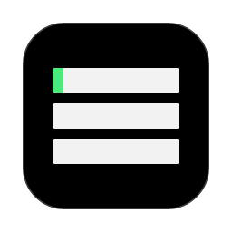
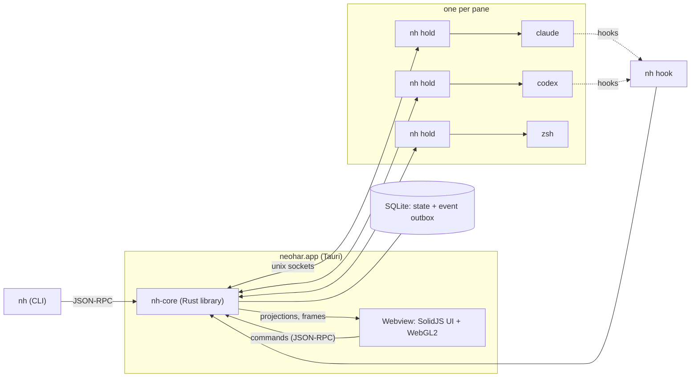

<div align="center">



# neohar

**One desktop workspace to supervise Claude Code and Codex.**

Your agents continue to run when the app quits. Their requests come to you, also when you do not look.

[](https://github.com/nikodem-wrona/neohar/actions/workflows/ci.yml)
[](https://github.com/nikodem-wrona/neohar/releases/latest)
[](LICENSE)


[Install](#install-from-source) · [Quick start](#quick-start) · [How it works](#how-it-works) · [Documentation](#documentation) · [Contributing](CONTRIBUTING.md)

</div>

<!--
  Screenshot: put a PNG of the window (the board, a card, an approval answered from a notification)
  in website/static/img/screenshot.png. Then replace this comment with the line below.
  <p align="center"></p>
-->

## Why neohar

When you run many coding agents at the same time, these problems occur:

| Problem | What neohar does |
|---|---|
| Each agent is in a different terminal. You must look at each one to know what it does. | The **board** shows a strip for each agent: its state, its work and its cost. |
| An agent stops to ask for an approval, and you do not see the request. | neohar **holds the request** and shows a card, a notification and a count in the Dock. You can answer from the phone too. |
| An agent stops when its terminal closes or the terminal app quits. | A small **holder process** owns each pane. Quit, crash or update the app, and the agents continue to run. |
| You do not know if your answer arrived. | Each answer has a **delivery record**: `delivered`, `resolved_elsewhere`, `delivery_unknown` or `delivery_failed`. |

neohar is not a new agent and not a new terminal. You use the real `claude` and `codex` CLIs, in real terminal panes, with their own dialogs. neohar adds the supervision.

## Features

**Supervise**

- **The board.** A strip for each agent shows a badge, the state (`WORK`, `WAIT`, `IDLE`, `DONE`, `ERR`, `RATE`, `END`), the work and the cost. The left edge is green when the agent works, amber when it waits for you and red after an error.
- **State from the harness.** The hooks of Claude Code and Codex give the state. neohar reads the screen only when no hook is available, and each state shows its source and its confidence.
- **The Timeline.** The turns, the tool calls, the tokens and the cost of the agent in the focused pane.

**Answer**

- **Approvals that wait for you.** When you do not look at a pane, neohar holds its approval. It shows the approval as a card in the Inbox, a tray entry and a native notification. When you click into the pane, the harness shows its own dialog.
- **Policy rules.** A rule in `config.toml` allows or denies a command before a person is asked. `nh policy suggest` proposes rules for the approvals that you always allow.
- **Every way in.** Answer from a card, a notification, the phone or the CLI. neohar records what occurred to each answer.

**Work**

- **Workspaces, tabs and panes.** Split, float or pop out panes. The Rust core parses the terminal output and the window draws it with WebGL2. The search finds text in the scrollback of all panes.
- **Tasks with worktrees.** A task gets its own git worktree, branch, port, tab and agent, with your prompt and your files.
- **Files and Changes.** The Files tab shows the folder of the focused pane. The Changes tab shows its git changes and diffs.

**Reach**

- **Remote machines.** The app connects over ssh to an `nh daemon` on another Mac and shows its panes next to your local panes.
- **The phone.** Pair a phone over Tailscale. It shows the desk, answers requests and gets a push when an agent needs you and no desktop window has the focus.
- **The `nh` CLI and the API.** The CLI uses the same JSON-RPC methods as the app. A script can do all that the window does.

## How it works



- **Holders are the durability core.** One `nh hold` process owns the PTY of each pane and keeps its output in a journal. When the app starts again, it restores each screen from a snapshot and the journal.
- **One core, one truth.** The core is a Rust library with a single command bus into a state actor. Each change is one SQLite transaction that updates the state and adds events.
- **A thin window.** The terminal parser, the selection and the keyboard encoding are in Rust. The webview gets binary frames, decodes them with WASM and paints them. It keeps no business state.
- **Hooks with a budget.** Claude Code and Codex call `nh hook`, a small shim with a budget of 5 ms. The shim holds an approval until you answer, or lets it go to the dialog of the harness.

[Architecture](website/docs/architecture/overview.md) gives the full design.

## Status

| Item | Status |
|---|---|
| Version | The [latest release](https://github.com/nikodem-wrona/neohar/releases/latest). neohar uses Semantic Versioning, and [CHANGELOG.md](CHANGELOG.md) records each release |
| macOS | The only tested platform, on Apple Silicon |
| Builds | Ad-hoc signed and not notarized. You build the app from source. There is no download and no updater |
| Linux | Not tested. The app can possibly build, but nobody verified it. Notifications are not built for Linux |
| Windows | Not a target. The core uses Unix sockets and PTYs |
| Claude Code | Validated: 2.1.x (recorded with 2.1.292) |
| Codex | Validated: 0.156.x (recorded with 0.156.1) |

neohar only observes a harness version that it did not validate: it shows the state, but it does not hold or answer the requests. [`golden-coverage.toml`](crates/nh-agents/golden-coverage.toml) lists the validated versions.

## Install from source

You need these programs:

- The Xcode Command Line Tools: `xcode-select --install`.
- git.
- [mise](https://mise.jdx.dev). mise installs the pinned Rust, Bun and cargo tools.

Run these commands:

```bash
git clone https://github.com/nikodem-wrona/neohar.git
cd neohar
mise install          # the pinned Rust, Bun and cargo tools
bun install           # the packages of the webview
mise run build:app    # target/release/bundle/macos/neohar.app, with nh inside
mise run app:install  # copy it to ~/Applications/neohar.app
```

The build has an ad-hoc signature and is not notarized, so use it on the Mac that built it. [Install the app](website/docs/guides/install.md) tells how to update and remove it.

## Quick start

1. Open the app: `open ~/Applications/neohar.app`.
2. Click **New workspace** at the bottom of the left column. You get a pane with your login shell.
3. Put `~/.local/bin` on your `PATH`, so that your shell finds `nh`.
4. Install the hooks of Claude Code and Codex: `nh integration install all`.
5. Check the install: `nh doctor`.
6. Type `claude` or `codex` in a pane.

For Codex, start Codex one time and choose "Trust all and continue", so that Codex runs the new hooks. Then read [Agents and approvals](website/docs/guides/agents-and-approvals.md).

### From the command line

Each action of the window is also a command:

```bash
nh agent start claude --split w3:p5 --prompt "Fix the failing test" --name fix-tests
nh agent wait fix-tests idle --timeout-ms 600000 --timeout 610
nh agent prompt fix-tests "Now run the whole suite"
nh policy suggest     # rules for the approvals that you gave 5 times and never denied
```

A policy rule in `config.toml` (`nh config edit`) answers an approval before it reaches you:

```toml
[[policy.rule]]
id = "pnpm-test"
decision = "allow"        # or "deny"
tool = "Bash"
command = "pnpm test:*"   # matches "pnpm test" and "pnpm test:unit", not "pnpm testing"
reason = "tests are safe"
```

A rule is not a sandbox. An allow never matches a line with more than one command, and a deny always wins.

## What leaves your Mac

- **No telemetry.** neohar sends no usage data and no crash reports, and it does no update check.
- **Web Push, only with a paired phone.** A paired phone can turn on notifications. Then the core sends encrypted pushes to the push service of the phone. The core sends pushes only to Apple, Google (FCM) and Mozilla ([`allow.rs`](crates/nh-web/src/push/allow.rs)). A push has the harness, the work of the agent and a short reason. It has no text of the agent.
- **Tailscale, only with the phone.** `nh phone publish` runs `tailscale serve`, which puts the phone listener on your tailnet with HTTPS. neohar never runs `tailscale funnel`.
- **ssh, only with remote machines.** The app uses the system `ssh` to connect to the machines that you put in `config.toml`.

The harnesses connect to their own services. neohar does not change what Claude Code or Codex sends.

## Documentation

The documentation site is in [`website/`](website/).

| To do this | Read |
|---|---|
| Use neohar | [Install the app](website/docs/guides/install.md), [Workspaces and panes](website/docs/guides/workspaces-and-panes.md), [Agents and approvals](website/docs/guides/agents-and-approvals.md) |
| Use more | [Tasks, files and changes](website/docs/guides/tasks-files-changes.md), [Remote machines](website/docs/guides/remote-machines.md), [The phone](website/docs/guides/phone.md), [Troubleshooting](website/docs/guides/troubleshooting.md) |
| Learn the words | [Introduction](website/docs/intro.md) and [Concepts](website/docs/concepts.md) |
| Understand the design | [Architecture](website/docs/architecture/overview.md), [Agents](website/docs/agents/overview.md), [Desktop app](website/docs/desktop/overview.md) |
| Write scripts | [Command line](website/docs/reference/cli/index.md), [API](website/docs/reference/api/index.md), [Configuration](website/docs/reference/configuration/index.md) |
| Change the code | [Setup for development](website/docs/getting-started/setup.md), [Development workflow](website/docs/getting-started/development-workflow.md), [Testing](website/docs/testing/overview.md) |

## Development

```bash
mise run check      # fmt, clippy, cargo-deny, ESLint, tsc, Prettier and the generated files
mise run test       # Rust tests (nextest), UI tests (bun test) and the install test
mise run app:dev    # the app from the working tree, with its config and data in target/dev-run
```

| Folder | Contents |
|---|---|
| [`crates/`](crates/) | The Rust workspace: the core (`nh-core`), the `nh` sidecar, the holder, the wire types, the terminal engine, the adapters, the phone server |
| [`apps/`](apps/) | The Tauri desktop app and the phone app |
| [`packages/`](packages/) | The SolidJS UI, the transport and the WASM decoder of the frames |
| [`tools/`](tools/) | The recorder of the harnesses, the mock model server, the test and bench tools |
| [`website/`](website/) | The documentation site (Docusaurus) |

[CONTRIBUTING.md](CONTRIBUTING.md) gives the full rules. [AGENTS.md](AGENTS.md) gives the rules for coding agents.

## Scope

neohar does a small number of things, and these are decided:

- **Two harnesses.** Claude Code and Codex, and no other. neohar has no plugin system and no generic agent protocol.
- **Not a terminal emulator product.** Plain shells must work well, but the product is the supervision of agents.
- **No Windows.** The core uses Unix sockets and PTYs.
- **No cloud.** No cloud sandboxes, no merge queue, no planner, and no coding agent of its own.

## Contributing

Issues and pull requests are welcome. Read [CONTRIBUTING.md](CONTRIBUTING.md) before you open a pull request. All persons in the project must obey the [code of conduct](CODE_OF_CONDUCT.md).

Do not report a vulnerability in a public issue. [SECURITY.md](SECURITY.md) tells how to report it privately.

## Acknowledgments

neohar uses the work of many projects, for example [Tauri](https://tauri.app), [alacritty_terminal](https://github.com/alacritty/alacritty), [SolidJS](https://www.solidjs.com), [SQLite](https://sqlite.org) through [rusqlite](https://github.com/rusqlite/rusqlite), [Tokio](https://tokio.rs) and [postcard](https://github.com/jamesmunns/postcard). [THIRD_PARTY_LICENSES.md](THIRD_PARTY_LICENSES.md) gives the licenses of all the code and data of other authors in `neohar.app`.

## License

neohar is licensed under the [Apache License 2.0](LICENSE).

neohar is not affiliated with Anthropic or OpenAI. Claude Code and Codex are trademarks of their owners.
