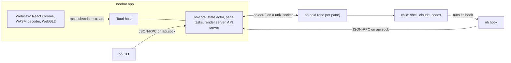

neohar is two binaries and many small processes. The app, `neohar.app`, links the core (`nh-core`) as a library and adds windows. Each pane has its own holder process, `nh hold`, which owns the PTY and is the parent of the program in the pane. Hooks, the command line, the headless daemon and the end of a remote link are other roles of the second binary, `nh`. The rule behind the design: the app is disposable, the processes are not. What must outlive the app is a separate process (a holder and its child) or a row in SQLite (`state.db`).

## The binaries and the roles of `nh`

| Process | Role | Lifetime |
|---|---|---|
| `neohar.app` | The core, the windows, menus, tray, notifications, deep links | Until the person quits it. Closing the last window leaves it in the menu bar |
| `nh hold` | One per pane: PTY master, output journal, child process ([Holders](/docs/architecture/holders)) | As long as the child lives |
| `nh hook <harness> <event>` | The shim that the hooks of Claude Code and Codex call. Exits 0 always; p50 ≤ 5 ms | One hook call |
| `nh <noun> <verb>` | The CLI, a client of `api.sock`. Same methods as the UI | One request |
| `nh daemon --detach` | The core without windows, for a remote Mac or as a local core that the app connects to | Until `nh daemon stop` or `session.shutdown` |
| `nh bridge` | The remote end of a link: copies bytes between ssh and `link.sock`, starts a daemon if none runs | One link |
| `nh askpass` | Brings a question of ssh or git (host key, passphrase, token) to a sheet of the app: for a link, or for a fetch of the Git view | One question |

`nh` is separate from the app because the shim has a 5 ms budget and the holder must stay small and rarely change (under 2,500 lines of code, checked by `mise run check:holder-size`). [crates/nh/src/main.rs](https://github.com/nikodem-wrona/neohar/blob/main/crates/nh/src/main.rs) picks the role from the first argument before any setup, so `hold` and `hook` never start the CLI parser.

**The symlink.** Hook configurations name one path, `~/.local/bin/nh`. A product build of the app points it at the `nh` inside its bundle at each launch, so an update never breaks a hook. A run with any `NEOHAR_*_DIR` override never touches it.

## How the pieces talk

| Channel | Ends | Format |
|---|---|---|
| Tauri IPC | Webview and host | Three commands only: `rpc`, `subscribe`, `stream`. Binary frames on a `Channel`; blobs on `nh://` ([The desktop app](/docs/desktop/overview)) |
| Holder socket | Core and one holder | `holder/2`: `u32` length plus a `postcard` body, at most 4 MiB |
| `api.sock` | Core and the CLI, the hook shim, tests | Newline-delimited JSON-RPC 2.0, at most 5 MiB a line ([API concepts](/docs/reference/api/concepts)) |
| `link.sock` | Core and a client on this or another Mac | `link/1` from `nh-remote` |
| Phone listener | Core and a paired phone, through `tailscale serve` | HTTP and a JSON-RPC WebSocket on `127.0.0.1:47310`, from `nh-web`, when `phone.enabled` is on |

The flows in short:

- **Keys in.** A `keydown` becomes a logical event with an `input_id`. The core's one encoder makes the bytes, the holder writes them and acknowledges the id ([Rendering and input](/docs/architecture/rendering-and-input)).
- **Bytes out.** The holder journals every byte, the pane task feeds the VT engine, and a pacer per window sends `postcard` frames that WASM decodes and WebGL2 draws.
- **Hooks.** A harness runs `nh hook`, which sends `adapter.signal` with the pane token. For `PermissionRequest` it waits on `adapter.gate` for a decision ([Interactions](/docs/agents/interactions)).
- **Calls.** A call that changes state commits one SQLite transaction that also appends its events. Projections push the change to every client ([The core](/docs/architecture/core)).

## Remote machines and the daemon

A core is a library with two hosts: the app and `nh daemon`. Both serve `link.sock` next to `api.sock`. A client app reaches a remote core over the system `ssh`, which runs `nh bridge` on the remote Mac; the bridge starts `nh daemon --detach` when no core serves the session. A window shows one machine, and its three commands go over the link unchanged.

On one Mac, the app first tries `link.sock` of its session. If a daemon answers, the app starts no core and is a client of the machine `local`. `mise run app:dev:client` runs this setup. How to add and use a machine is on [Remote machines](/docs/guides/remote-machines).

## What survives what

| Event | Programs in panes | Screens |
|---|---|---|
| Quit (⌘Q) | Keep running | Exact: each pane checkpoints at a cut point (at most 1 s), then detaches |
| Crash or `SIGKILL` of the app | Keep running | Snapshot plus journal replay; the chaos test found 0 differences in 3,759 screens |
| Update | Keep running | As quit and launch. `holder/2` is the only version so far. The updater is not built |
| Holder killed | The child normally ends | Last screen stays, the pane is `lost`; `pane.restart` starts it again |
| Reboot | Gone | A login shell in the old directory; agents resume per `agents.resume_on_launch` |

[Holders](/docs/architecture/holders) has the restart flow.

## Directories

One module, [crates/nh-proto/src/paths.rs](https://github.com/nikodem-wrona/neohar/blob/main/crates/nh-proto/src/paths.rs), computes every path.

| Root | macOS | Linux | Holds |
|---|---|---|---|
| Config | `~/.config/neohar` | `$XDG_CONFIG_HOME/neohar` | `config.toml`, `harnesses/*.toml`, `workflows/*.toml` |
| Data | `~/Library/Application Support/dev.neohar.app/<session>` | `$XDG_DATA_HOME/neohar/<session>` | `state.db`, `scrollback/`, `blobs/`, `logs/`, `shims/`, `workflows/executions/` |
| Runtime | `/tmp/neohar-$UID/<session>` | `$XDG_RUNTIME_DIR/neohar/<session>` | `api.sock`, `link.sock`, `holders/<pane>.sock`, `ssh/` |

- The macOS runtime root is under `/tmp`, because a socket path under `$TMPDIR` is longer than the macOS limit of 103 bytes. The core uses it only if it is a real directory of the user with mode 0700. Another user can make it first, so the clients check it too before they connect (see the security model).
- `NEOHAR_CONFIG_DIR`, `NEOHAR_DATA_DIR` and `NEOHAR_RUNTIME_DIR` replace the roots. Every test sets all three, and a debug build refuses to start without them. `mise run app:dev` sets them under `target/dev-run`.

## Budgets

Numbers are from measurements on a Mac with an Apple M4 and a 60 Hz display. [Local suites](/docs/testing/local-suites) shows how to run them.

| Metric | Target | Measured |
|---|---|---|
| Keypress → PTY, in the core / from the page | ≤ 1 ms / ≤ 3 ms p99 | 0.43 ms / 2.04 ms |
| Keypress → painted | ≤ 16 ms p99 at 60 Hz | 16 ms (at the limit) |
| PTY output → painted | ≤ 1 frame + 2 ms p99 | 15.2 ms |
| CPU: 20 panes, 3 spinners, window unfocused | < 2% of a core | 1.72–1.87% |
| CPU of a holder: idle / 10 events a second | < 0.03% / < 0.15% | 0.01% / 0.08% |
| Full redraw 200×60: core, decode, draw | ≤ 4 ms, ≤ 2 ms, ≤ 1 ms | 2.9 ms, 0.82 ms, CPU 0.14 ms (GPU time not proven) |
| Memory per pane (≤ 120 columns) | < 4 MB | 3.75 MB at 120 columns |
| Cold start to first painted window | < 500 ms | 299–396 ms |
| Reattach 20 panes | < 1 s | median 16 ms |
| UI bundle gzipped: desk, phone / first chunk of the phone | < 400 KB each / < 250 KB | 307.0 KB, 315.1 KB / 224.3 KB |
| Hook shim through the symlink | p50 ≤ 5 ms | 1.3–1.4 ms |
| Link cost, key to frame | ≤ 1 ms p99 | 0.39 ms (no ssh) |

Not proven yet: GPU time of a draw, 120 Hz, the renderer on Linux, and the link budgets over real ssh to a second machine.

## Security model

- **Agent output is untrusted.** Terminal bytes reach only the VT engine in Rust and a canvas. Markdown is cleaned by `ammonia` in `nh-rich`; card text is shown as text nodes, never `innerHTML`.
- **The webview is sandboxed.** It may call three commands and nothing else; plugins are called from Rust only. The CSP allows no remote origin, and navigation stays inside the app. `mise run test:host` checks this in a real window.
- **Only the user's processes reach the core.** Sockets have mode 0600 in 0700 directories, and the core checks the peer user id. A holder also needs a 32-byte secret and a fencing token.
- **Only the user's core gets the data of a client.** The app, the CLI, the hook shim and `nh bridge` do not connect to a socket in a directory that another user owns or can write. After the connect, they close a socket that a process of another user serves, and send nothing to it. The app shows the problem and starts no core. `nh @<machine>` uses `ssh/` only in a safe runtime root.
- **Scopes.** A request is `ui`, `cli`, `pane` (carries a pane token, may call only `adapter.*`), `phone` (a paired phone, may call only some methods) or `dev`. A request with a pane token cannot answer an interaction. A `cli` client whose parent processes include the holder of a pane may not answer interactions or weaken the approvals ([`in_pane.rs`](https://github.com/nikodem-wrona/neohar/blob/main/crates/nh-core/src/in_pane.rs)). This is not a sandbox: a process that leaves the process tree of its pane gets past it.
- **Redaction.** `nh-redact` masks secrets in event payloads, logs and debug bundles. Scrollback and snapshots stay on disk as they are, with mode 0600.
- **Links.** ssh authenticates the person. A client accepts only limited host requests from a remote core.
- **The phone listener.** It is off by default. With `phone.enabled` on, the core listens on `127.0.0.1:47310` (`phone.port`), never on another address. `tailscale serve` puts that port on the tailnet with HTTPS. A phone pairs with a code and gets a cookie; every route except the pairing and the files of the phone app needs that cookie.
- **Not containment.** Any process of the same user can read a pane token. Builds and the DMG of a release are ad-hoc signed and not notarized.
