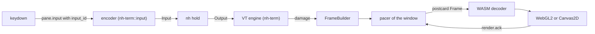

All terminal logic is in Rust. The core parses the bytes, keeps the screen model, tracks damage and builds binary frames. The webview decodes the frames with a WASM build of the same Rust types and draws them with one WebGL2 context per window. In the other direction, the webview sends logical key and mouse events, and the core's one encoder turns them into bytes. JavaScript never sees terminal bytes ([the thin-presentation rule](/docs/desktop/overview#the-thin-presentation-rule)).

## The VT engine

Each pane has one engine behind the trait `VtEngine` ([engine.rs](https://github.com/nikodem-wrona/neohar/blob/main/crates/nh-term/src/engine.rs)). The implementation is `AlacrittyEngine` on `alacritty_terminal` 0.26 with `vte` 0.15. `wezterm-term` is the named fallback behind the same trait. Neither Claude Code nor Codex uses image protocols or OSC 133, which the engine lacks.

- **Effects** of output (query replies, bell, title, OSC 52, OSC 9 and 777 notifications) go to an effect sink. During a replay the sink drops them all.
- **Helpers** fill gaps of `alacritty_terminal`: an interceptor answers DA3 and XTVERSION, a mirror keeps state that `Term` does not expose (tab stops, keyboard stacks, mouse modes), and a tracker counts the lines that leave the screen for the archive.
- **History** in memory stays below 900 lines, so a pane never allocates a second block of grid rows. Older lines are in the archive.
- **Snapshots** are `nh-term`'s own `postcard` format, taken only at cut points, so they hold no parser state. A 200×60 restore takes 0.41 ms (budget 5 ms).

## Frames are state sync

A frame is not a byte relay. Each frame has `{pane, reset_epoch, base_rev, rev}` and applies only to a client whose state is exactly `base_rev`. Otherwise the client drops it and asks for a keyframe. A slow client gets fewer, larger deltas and never blocks the pane.

- `FrameBuilder` ([frame_builder.rs](https://github.com/nikodem-wrona/neohar/blob/main/crates/nh-term/src/frame_builder.rs)) keeps the revision at which each row last changed. Each client (a window or a peek) has its own revision and its own set of known styles and graphemes, so many clients follow one pane at their own pace.
- Styles and grapheme clusters are interned per epoch. The epoch grows on a resize or when an interner is full, and every client then gets a keyframe.
- Damage is **minor** when it touches at most 2 rows and 16 cells and the cursor stays on its row: a spinner.

**Wire format.** Frames are `postcard`, defined once in [nh-proto](https://github.com/nikodem-wrona/neohar/blob/main/crates/nh-proto/src/frame.rs) and compiled into the core and the WASM decoder. Evolution is append-only, and frozen fixtures catch a change. A row is a byte string of packed 6-byte cells: a `u32` glyph (or a grapheme id with bit 31 set) and a `u16` style id. A 200×60 keyframe is about 72 KB. On a render stream one message is one frame, with no length prefix. The frame version is `FRAME_PROTO = 1`.

## The render server and the pacer

The render server ([render/mod.rs](https://github.com/nikodem-wrona/neohar/blob/main/crates/nh-core/src/render/mod.rs)) knows the windows and the panes each one shows. A window has one render stream and one pacer task:

1. Damage inside one display period becomes one frame. A tick that sends nothing does not start a period, so an echo after a quiet time goes out at once.
2. A hidden window gets nothing; it gets keyframes when it is shown again.
3. A pane has at most 2 frames in flight. Over a link the limit is `max(2, ceil(rtt / period) + 1)`, at most 8.
4. A visible pane without focus and with only minor damage sends at most once a second, on one clock per window. A repaint of the system webview costs about 20 ms of CPU whatever its size, so the repaint rate sets the cost.

The page sends `render.ack` at most once per painted animation frame. An ack frees the frames in flight up to that revision; `need_keyframe` names panes whose frames the decoder dropped.

Two more streams use the same builder. `peek` sends small keyframes of the bottom rows of a pane, at most 4 a second, for the hover preview of a tab. `scrollback` reads styled pages of up to 200 lines from the archive.

## The webview side

- **WASM decoder** ([packages/proto-wasm](https://github.com/nikodem-wrona/neohar/tree/main/packages/proto-wasm)). JavaScript writes a frame into WASM memory and calls `decode_input`. The decoder checks the frame against the pane and only then applies it to typed arrays of cells and styles. After warm-up a frame of unchanged size allocates nothing.
- **WebGL2 renderer** ([packages/ui/src/surface](https://github.com/nikodem-wrona/neohar/tree/main/packages/ui/src/surface)). One context per window draws every visible pane with a scissor, one instanced draw per pane. Only the rows that the decoder marked are uploaded. Glyphs come from an atlas of 8,192 slots, rasterized once with an offscreen canvas, so font fallback and emoji come from the browser.
- **Canvas2D fallback.** Same interface and the same pixels (0 of 14,080 cells differ by more than 3 levels). It is chosen when WebGL2 is absent or the GPU is a software renderer. The status bar shows which one runs.
- **Fonts.** `ui.font_family` and `ui.font_size` set the font. The page measures integer cell metrics and reports them with `window.report_metrics`; the core uses them for `CSI 14 t`. The app serves fonts that the person installed to the webview. No ligatures in v1.
- **Overlays.** The scrollbar, the strip of a pane (exit code, unconfirmed inputs, clipboard requests) and an off-screen text mirror for screen readers sit above the canvas. Terminal content never positions anything in the DOM.

## Input

The webview sorts out what only a browser knows (input methods, dead keys, AltGr, the Option key of macOS, the app's own chords) and sends **logical events** with an `input_id`. The core holds the **one canonical encoder** ([crates/nh-term/src/input](https://github.com/nikodem-wrona/neohar/tree/main/crates/nh-term/src/input)), which turns each event into bytes for the modes the pane has at that moment. The CLI uses the same encoder, so a key gives the same bytes whatever sends it. Keys are never batched.

| Logical event | Fields |
|---|---|
| `key` | `code` (physical key), `key` (in the layout of the user), `mods`, `kind` (`press`, `repeat`, `release`), `text?`, `location` |
| `mouse` | `kind` (`down`, `up`, `move`, `wheel`), `button`, `col`, `row`, `mods`, wheel notches |
| `text` | The result of an input method or a dead key |

- **Keyboard layer** ([keyboard.ts](https://github.com/nikodem-wrona/neohar/blob/main/packages/ui/src/input/keyboard.ts)). An input method owns a key while it composes, and its result comes as `text`. AltGr and the Option key make characters; `ui.macos_option_as_alt` makes Option an Alt key per side. A release goes out only when the program asked for kitty flag 2.
- **Encoder.** Legacy xterm forms, `modifyOtherKeys`, the kitty keyboard protocol (flags 1 to 16), mouse modes and encodings, paste and focus. Where the documents leave a case open, the encoder picks one answer. The keyboard matrix checks 968 cases in Rust and 847 in WebKit and Chromium against bytes from the documents, never from the encoder.
- **App chords.** While a pane has focus, it gets every key except the reserved chords of the keymap, matched by physical key. ⌘⌥V passes the next key through ([The UI](/docs/desktop/ui)).
- **Mouse.** A program that asked for the mouse gets it; Shift bypasses it for a selection. Moves and wheel steps are merged per animation frame. Without a mouse mode, the wheel scrolls the history in the core.
- **Paste.** Line ends become carriage returns. With bracketed paste on, the text goes between the markers, and any end marker inside it is removed first. One write is at most 1 MiB.
- **Paths.** `pane.drop_files` and `pane.insert_paths` (the Files tab) quote each path in POSIX single quotes and paste them. The host refuses `pane.drop_files` from a window of a remote machine: the paths of this Mac name nothing there, and the host uploads no file of this Mac. A phone attaches files with `pane.drop_blobs`.

Every input is at most once: the holder writes an id once and acknowledges it, and an input without an ack is reported, never replayed ([Holders](/docs/architecture/holders)).

## Selection and the clipboard

- **Selection lives in the engine** ([selection.rs](https://github.com/nikodem-wrona/neohar/blob/main/crates/nh-term/src/selection.rs)). Points are absolute lines, so a selection stays on its lines while output scrolls. The engine widens it to a word, a line or a wide character, and every frame carries the result, so the UI draws exactly what will be copied. A resize clears it. It covers the lines in memory; `pane.read` reads archive lines.
- **Copy** is `pane.copy`: the core reads the text and writes it through the host. The copy chord (⌘C, or Ctrl+Shift+C off macOS) never reaches the program.
- **OSC 52 writes** ask once per pane. The strip shows Allow, Deny and "Remember for this pane". **OSC 52 reads are never answered**, and a replay never writes the clipboard.

## Not built yet

| Planned | As built |
|---|---|
| Frames confirm inputs in `ack_status` | Always empty; the pane strip reads unconfirmed inputs from the `panes` projection |
| A webview without acks for 30 s is dropped | No timer; two frames in flight stop a pane until an ack or a new stream |
| A multi-line paste into an agent asks first | `pane.paste` writes at once, and the API has no confirmation method |
| Focus reports (mode 1004) | The encoder has them; the core does not send them |
| Real captures of keyboard layouts in the webview | Not made; the cases for dead keys, AltGr and input methods are modelled |
