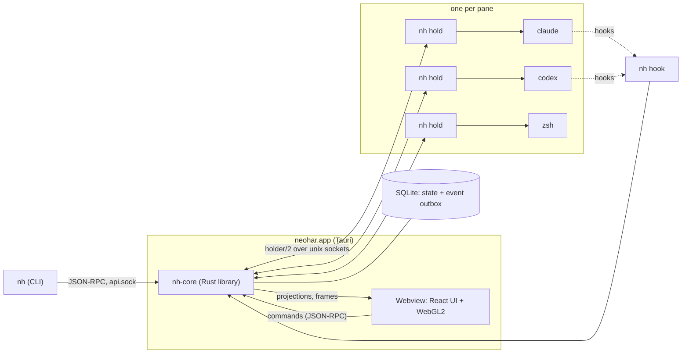

neohar is a desktop workspace for supervising coding agents. A Rust core owns the terminals, the state of the agents and their approvals. It keeps every agent process alive when the app quits, crashes or updates. The window is a thin surface: it paints what the core sends and sends back what the person did.

neohar supports two harnesses, **Claude Code** and **Codex**, and nothing else.

## Three ideas

- **Agent state comes from the harness.** Hooks, protocol streams and transcripts give the state. Reading the screen is the last fallback, and every state says where it came from and how sure it is. See [Agents](/docs/agents/overview).
- **Approvals, questions and plan reviews are objects.** Each has an id, a risk and a delivery transaction, so the fate of every answer is known. See [Interactions](/docs/agents/interactions).
- **Processes outlive the app.** A small holder process owns each pane. Quit or kill the app and the agents keep running; relaunch and the screens come back. See [Holders](/docs/architecture/holders).

## The shape of the system

- **Two binaries.** `neohar.app` links the core as a library. `nh` is a small sidecar: the holder of a pane (`nh hold`), the hook shim (`nh hook`), the command line, and the core without windows (`nh daemon`).
- **The core** has one command bus into a state actor. Each change is one SQLite transaction that updates the state and appends events. Clients read in-memory projections.
- **Rendering happens in Rust.** The webview gets binary frames of packed cells, decodes them with WASM and draws them with WebGL2.
- **The webview holds no business state.** It speaks the same JSON-RPC methods as the CLI. See [Desktop app](/docs/desktop/overview).

## What works today

- **On one Mac**: workspaces, tabs and panes; Claude Code and Codex in panes, with their state on the board; approvals and questions as cards, notifications or CLI calls; policy rules; the Files and Changes tabs; the Git view of a repository and its worktrees; and the `nh` command line.
- **Workflows**: graphs of Claude Code and Codex agents on a canvas. An execution in a folder gives one report ([Workflows](/docs/guides/workflows)).
- **Remote machines**: the app connects over ssh to an `nh daemon` on another Mac and shows its panes ([Remote machines](/docs/guides/remote-machines)).
- **A phone app**: the core serves it on `127.0.0.1`, and `tailscale serve` puts it on your tailnet. A paired phone shows the desk, answers requests, and gets a push when an agent needs you and no desktop window has the focus ([The phone](/docs/guides/phone)).
- macOS is the only tested platform. Each release has a DMG for Apple silicon. Builds are ad-hoc signed and not notarized, and the app has no updater.

## Where to go next

| You want to | Read |
|---|---|
| Use neohar | [Install](/docs/guides/install), then [Workspaces and panes](/docs/guides/workspaces-and-panes) |
| Learn the words | [Concepts](/docs/concepts) |
| Build and change the code | [Setup](/docs/getting-started/setup) and [Development workflow](/docs/getting-started/development-workflow) |
| Understand the design | [Architecture](/docs/architecture/overview), [Agents](/docs/agents/overview), [Desktop app](/docs/desktop/overview) |
| Script neohar | [Command line](/docs/reference/cli) and [API](/docs/reference/api) |
| Find a crate or a tool | [Code](/docs/code) |

## Non-goals

These are decided:

- A plugin system, or a harness adapter outside the core.
- A terminal emulator product. Plain shells must be good, but the product is agent supervision.
- Windows: the core uses Unix sockets and PTYs.
- Cloud sandboxes, a merge queue, a planner, or a coding agent of its own.
